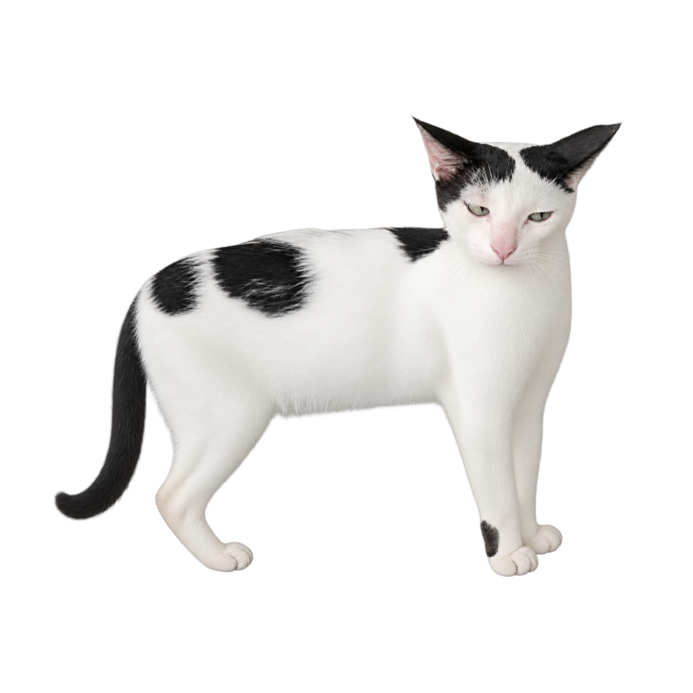

  

<h1 align="center">MeowBonk · 王之蔑视</h1>

<strong>一只冷眼旁观，召之即来的桌面小猫</strong>

  
  
  
  

---

MeowBonk 是一只带着不屑眼神的桌面奶牛猫。按住组合键并点击，小猫就会跑过去撞一下，再弹回去继续冷眼旁观。

## 主要功能

- **点击召唤**：按住 Option + Shift 并点击左键，小猫跑向点击位置。
- **随时暂停**：右击静止的小猫，启用或暂停召唤，也可以打开设置、查看应用信息或退出。
- **记住选择**：自动保存启用或暂停状态，下次启动时恢复。
- **本地运行**：无需账号，离线使用。

组合点击只用于召唤小猫，不会触发下方应用；普通点击照常。

## 使用方法

1. 打开 MeowBonk，小猫会出现在桌面上。
2. 右击静止的小猫，打开设置与使用说明。
3. 根据提示授予所需权限，点击「演示撞击」试试。
4. 启用召唤，在主显示器上按住 **Option + Shift + 左键** 点击想让小猫撞击的位置。

首次启动默认暂停。关闭设置窗口后，小猫继续留在桌面；需要暂停或退出时，右击静止的小猫选择相应菜单项。

## 权限与隐私

在 macOS「系统设置 → 隐私与安全性」中，为 MeowBonk 授予以下权限：

- **输入监控与辅助功能**：接收组合键和鼠标操作，让组合点击只用于召唤小猫。
- **屏幕录制**：获取点击位置附近的局部画面，用于撞击效果。

如系统提示需要重启应用，退出后重新打开即可。「演示撞击」需要屏幕录制权限，无需输入监控或辅助功能权限。

截取的画面只在内存中短暂使用，不保存或上传；不记录键入内容，不采集音频。

## 许可证

本项目采用 [MIT License](./LICENSE)。
